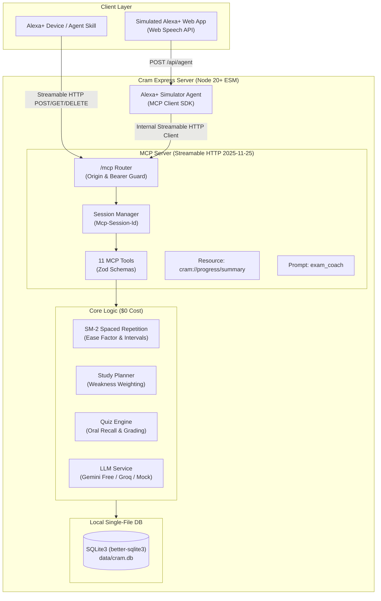

# Cram 🎓 — Voice Exam Coach for Alexa+

> **Amazon Developer Hackathon (Devpost) — Alexa+ Track Submission**  
> A self-hosted **Model Context Protocol (MCP)** server (`2025-11-25` Streamable HTTP) coupled with an **Alexa+ Voice Simulator** that coaches students through spoken quizzes, SM-2 spaced repetition, and personalized day-by-day study schedules. Runs completely for **$0**.

[](LICENSE)
[](https://nodejs.org/)
[](https://spec.modelcontextprotocol.io/)
[](https://modelcontextprotocol.io/)

---

## 💡 The Problem
College and high school students face multiple overlapping midterm and final exams (e.g. *Discrete Structures*, *Algorithms*, *Computer Architecture*). Traditional study methods suffer from:
1. **Passive reading illusion**: Students re-read notes without testing active recall.
2. **Poor time allocation**: Students waste hours on topics they already know rather than drilling concepts they fail.
3. **High friction**: Sitting down to open a laptop or book feels daunting compared to hands-free voice coaching while cooking, walking, or resting.

## ⚡ What Cram Does
Students say:
* *"Alexa, add my DSGT exam on November 15."*
* *"Alexa, make me a study plan."*
* *"Alexa, quiz me on graph theory for 10 minutes."*

Cram stores exams and syllabus topics, dynamically generates a day-by-day plan weighting weak topics, conducts one-question-at-a-time oral quizzes scored by AI, and applies the **SuperMemo SM-2** spaced repetition algorithm so weak concepts return sooner.

---

## 🏛️ Architecture Overview



---

## 🚀 Quickstart in 5 Steps

### 1. Clone the repository
```bash
git clone https://github.com/your-username/cram.git
cd cram
```

### 2. Install dependencies
```bash
npm install
```

### 3. Setup environment variables
```bash
cp .env.example .env
```
*(Optional: add your free `GEMINI_API_KEY` from [Google AI Studio](https://aistudio.google.com/). If left blank, Cram automatically falls back to an offline deterministic mock so everything runs $0 with zero keys required!)*

### 4. Seed demo data
Populates demo exams (DSGT, AOA, COA), 15 syllabus topics, a 5-day study streak, and today's schedule:
```bash
npm run seed
```

### 5. Launch Cram
```bash
npm run dev
```
Open [http://localhost:3000](http://localhost:3000) in Chrome/Edge. Tap the big Alexa mic or type to talk!

---

## 🔌 How Cram Uses MCP (Code References)

Cram implements the **Model Context Protocol (MCP)** specification (`2025-11-25`) using `@modelcontextprotocol/sdk`:

| MCP Component | Implementation File | Description |
|---|---|---|
| **Streamable HTTP Router** | [`src/mcp/transport.ts`](file:///c:/Users/Rutikesh/OneDrive/文档/Desktop/Projects/Cram/src/mcp/transport.ts) | Implements `/mcp` handling POST (JSON-RPC), GET (SSE stream), and DELETE (session close) with `Mcp-Session-Id` tracking and DNS-rebinding origin protection. |
| **Server Factory** | [`src/mcp/createServer.ts`](file:///c:/Users/Rutikesh/OneDrive/文档/Desktop/Projects/Cram/src/mcp/createServer.ts) | Constructs `McpServer({ name: 'cram', version: '1.0.0' })` registering tools, resources, and prompts. |
| **Tool Registry (11 Tools)** | [`src/mcp/tools/*.ts`](file:///c:/Users/Rutikesh/OneDrive/文档/Desktop/Projects/Cram/src/mcp/tools) | 11 dedicated tool definitions with strict `zod` schemas and voice-friendly concise text blocks. |
| **MCP Resource** | [`src/mcp/createServer.ts`](file:///c:/Users/Rutikesh/OneDrive/文档/Desktop/Projects/Cram/src/mcp/createServer.ts) | Exposes `cram://progress/summary` providing full text metrics across all exams. |
| **MCP Prompt** | [`src/mcp/createServer.ts`](file:///c:/Users/Rutikesh/OneDrive/文档/Desktop/Projects/Cram/src/mcp/createServer.ts) | Exposes `exam_coach` system prompt enforcing under-2-sentence spoken Alexa replies. |
| **MCP Client Simulator** | [`src/api/agent.ts`](file:///c:/Users/Rutikesh/OneDrive/文档/Desktop/Projects/Cram/src/api/agent.ts) | Connects to `http://localhost:3000/mcp` via `StreamableHTTPClientTransport`, discovers tools, and executes them over Streamable HTTP. |

---

## 🛠️ MCP Tools Reference (11 Tools)

Every tool returns a concise, voice-friendly response in a `text` block (under 2 sentences) plus `structuredContent` for data inspection:

| Tool Name | Parameters | Purpose | Voice Output Example |
|---|---|---|---|
| `add_exam` | `{ subject, examDate, topics? }` | Adds an upcoming exam and syllabus topics | *"Added your DSGT exam on 2026-11-15, which is in 14 days, with 5 topics."* |
| `list_exams` | `{}` | Lists upcoming exams with remaining days countdown | *"You have 3 upcoming exams: DSGT in 14 days, AOA in 21 days, and COA in 28 days."* |
| `add_topics` | `{ examId, topics[] }` | Adds syllabus topics to an existing exam | *"Added 3 new topics to DSGT: Graph Theory, Trees, and Logic."* |
| `make_study_plan` | `{ examId, hoursPerDay? }` | Generates day-by-day plan weighted by weakness | *"Created a 14-day study plan for DSGT with 2 hours per day. Weakest topics are prioritized first."* |
| `get_today_plan` | `{}` | Retrieves today's tasks across all exams | *"Today you have 3 study tasks totaling 120 minutes: 60 minutes on Graph Theory..."* |
| `start_quiz` | `{ examId, topic?, minutes? }` | Starts oral quiz and returns first question | *"Starting a 10-minute quiz on Graph Theory. First question: What is the maximum number of edges in a simple graph?"* |
| `answer_question` | `{ sessionId, answer }` | Grades answer, updates SM-2, gives next question | *"Spot on! That was an accurate explanation. Next question on Trees: What is the minimum height of a binary tree?"* |
| `end_quiz` | `{ sessionId }` | Terminates quiz early with performance summary | *"Quiz ended early. You completed 3 questions with an average score of 85%."* |
| `get_progress` | `{ examId? }` | Retrieves streak, minutes, and topic mastery | *"You're on a 5-day study streak with 160 total minutes studied. Average mastery is 51%."* |
| `log_study_session` | `{ examId, topic, minutes }` | Logs self-study time for streaks and analytics | *"Logged 30 minutes of study for Graph Theory in DSGT. Keep up the great work!"* |
| `weak_topics` | `{ examId }` | Returns topics needing urgent review | *"Your weakest topics in DSGT are Graph Theory at 35% mastery and Recurrence Relations at 40%."* |

---

## 🧠 Spaced Repetition (SuperMemo SM-2)

Cram implements the classic **SM-2 algorithm** per `(exam, topic)`:
* **Ease Factor (EF)**: Defaults to `2.5`, floor at `1.3`. Formula:
  $$\text{EF}' = \text{EF} + (0.1 - (5 - q) \cdot (0.08 + (5 - q) \cdot 0.02))$$
* **Quality Grade ($q \in [0, 5]$)**: Converted from AI score ($0-100\%$).
* **Interval ($I$)**:
  * $q < 3$ (Failed): Repetitions reset to $0$, interval = 1 day.
  * $q \ge 3$ (Passed): Rep $1 \to 1\text{ day}$, Rep $2 \to 6\text{ days}$, Rep $n \to I_{n-1} \times \text{EF}'$.
* **Mastery Score ($0-100$)**: Rolling Exponential Moving Average ($60\%$ current grade, $40\%$ previous mastery).

---

## ⚙️ Environment Variables

Documented in `.env.example`:

| Variable | Default | Required? | Description |
|---|---|---|---|
| `PORT` | `3000` | Optional | Port on which Express server and `/mcp` listen |
| `GEMINI_API_KEY` | *(empty)* | Optional | Google Gemini Free tier key from AI Studio |
| `GROQ_API_KEY` | *(empty)* | Optional | Optional Groq key for ultra-fast Llama-3.3 fallback |
| `MCP_AUTH_TOKEN` | *(empty)* | Optional | Bearer token required on `/mcp` if set |
| `DB_PATH` | `./data/cram.db` | Optional | SQLite database file location |
| `PUBLIC_BASE_URL` | `http://localhost:3000` | Optional | Public base URL for reverse proxies and Alexa+ |
| `ALLOWED_ORIGINS` | `http://localhost:3000` | Optional | Comma-separated allowed origins for DNS rebinding guard |

---

## 🌐 Public Deployment & Alexa+ Registration

### Option 1: Quick Free Tunnel (for Live Testing)
```bash
# Using Cloudflare Tunnels (free, no account needed)
cloudflared tunnel --url http://localhost:3000

# Or using ngrok
ngrok http 3000
```
This gives you a public HTTPS URL (e.g. `https://random-subdomain.trycloudflare.com`).

### Option 2: Render ($0 Free Cloud Hosting)
1. Fork or push this repository to GitHub.
2. In [Render Dashboard](https://dashboard.render.com/), choose **New Blueprint** and select your repo.
3. Render automatically reads [`render.yaml`](file:///c:/Users/Rutikesh/OneDrive/文档/Desktop/Projects/Cram/render.yaml) and deploys the free Node.js service!

### Registering with Alexa+
When the Alexa+ Agent Skill portal or Alexa+ Developer Console prompts for an MCP endpoint:
1. Provide your public endpoint URL: `https://your-domain.com/mcp`
2. Transport: **Streamable HTTP** (Spec `2025-11-25`)
3. Optional Bearer Token: Set `MCP_AUTH_TOKEN` in your environment and configure the matching token in Alexa Developer Console.
4. Alexa+ discovers all 11 tools automatically via `tools/list`!

---

## 🧪 Testing

Run unit tests (SRS math, study planner) and full end-to-end integration tests over Streamable HTTP:
```bash
npm test
```
To test with the official MCP Inspector:
```bash
npm run build
npm run mcp:inspect
```

---

## 📄 License
This project is licensed under the **MIT License** — see the [LICENSE](LICENSE) file for details.
